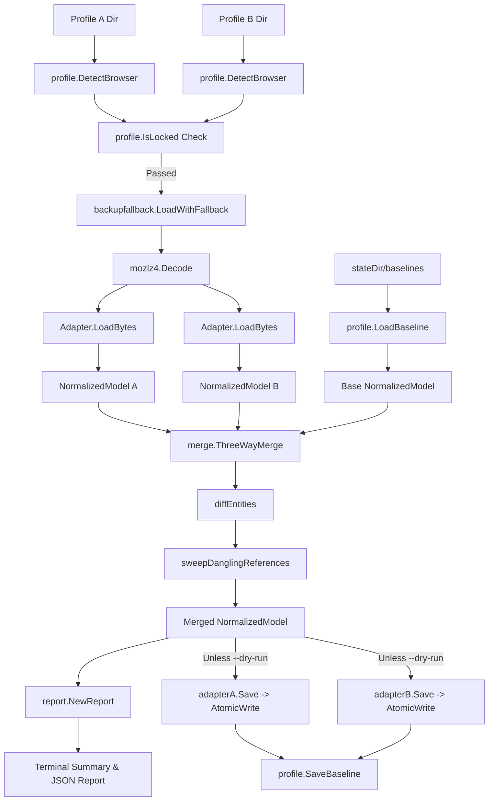

# Technical Architecture & Developer Reference

This document details the software architecture, design principles, data models, and internal workflows of `mozsession-merge`.

---

## 1. Package Overview

```
mozsession-merge/
├── cmd/
│   └── mergetabs/
│       └── main.go                 # CLI entrypoint (cobra), delegates to pkg/mergetabs
├── pkg/
│   └── mergetabs/
│       └── mergetabs.go            # Programmatic merge runner & public Options API
├── internal/
│   ├── mozlz4/
│   │   ├── codec.go                # mozLz4 magic header + LE size + LZ4 block codec
│   │   └── codec_test.go
│   ├── model/
│   │   ├── model.go                # NormalizedModel & core Entity definitions
│   │   ├── identity.go             # Navigation history tab ID synthesis
│   │   ├── strip.go                # Ephemeral field stripping & content equality
│   │   └── model_test.go
│   ├── adapter/
│   │   ├── adapter.go              # Adapter interface & DetectAdapter dispatcher
│   │   ├── firefox/                # Firefox sessionstore.jsonlz4 adapter
│   │   └── zen/                    # Zen zen-sessions.jsonlz4 adapter
│   ├── merge/
│   │   ├── merge.go                # ThreeWayMerge core entry point
│   │   ├── diff.go                 # Generic 3-way entity diff engine
│   │   ├── conflict.go             # Strategy conflict resolvers (newer, keep-both, manual)
│   │   ├── integrity.go            # Post-merge dangling reference sweeper
│   │   └── merge_test.go
│   ├── profile/
│   │   ├── locate.go               # Profile browser detection
│   │   ├── lock.go                 # Lock file (.parentlock) + /proc process scanner
│   │   ├── baseline.go             # Baseline snapshot manager
│   │   └── profile_test.go
│   ├── backupfallback/
│   │   ├── fallback.go             # Recovery/backup file fallback chain reader
│   │   └── fallback_test.go
│   ├── writer/
│   │   ├── atomic.go               # Atomic file writer with pre-write .bak copy
│   │   └── writer_test.go
│   └── report/
│       ├── changelog.go            # Human-readable & JSON report generator
│       └── report_test.go
└── test/
    └── integration_test.go         # End-to-end integration test suite
```

---

## 2. End-to-End Data Flow



---

## 3. Core Architecture Concepts

### 3.1 `NormalizedModel` (`internal/model`)
The 3-way merge core is browser-agnostic. All browser-native session representations are parsed into `NormalizedModel`:
```go
type EntityID string

type Entity struct {
    ID  EntityID
    Raw map[string]any // Browser-native payload, opaque to merge core
}

type NormalizedModel struct {
    Tabs          []Entity
    Spaces        []Entity
    Groups        []Entity
    Folders       []Entity
    SplitViewData []Entity
    ClosedTabs    []Entity
    Meta          Meta
}
```

### 3.2 Tab Identity & Synthesis (`identity.go`)
- **Zen Tabs**: Use native `zenSyncId` string directly.
- **Stock Firefox Tabs**: Deterministically synthesized using FNV-64a hash of full navigation history URLs, `userContextId`, and `pinned` state (`SynthesizeTabID`).

### 3.3 Content Equality & Ephemeral Field Stripping (`strip.go`)
Before checking content equality between two versions of an entity, session-instance fields (`_zenIsActiveTab`, `lastAccessed`, `index`, `requestedIndex`, `userTypedValue`, `userTypedClear`) are stripped so that trivial focus or scroll changes do not cause false edit conflicts.

### 3.4 Generic 3-Way Diff Engine (`internal/merge/diff.go`)
Performs 3-way comparison across `Tabs`, `Spaces`, `Groups`, `Folders`, and `SplitViewData`:
- **Unchanged on both sides** $\rightarrow$ Keep version.
- **Changed on local only** $\rightarrow$ Take local version.
- **Changed on remote only** $\rightarrow$ Take remote version.
- **Changed on both differently** $\rightarrow$ Invoke conflict resolver (`resolveConflict`).
- **Deleted on one side, unchanged on other** $\rightarrow$ Remove from merged model.
- **First-run mode (no baseline)** $\rightarrow$ Perform union merge with first-run warning log.

### 3.5 Dangling Reference Sweep (`internal/merge/integrity.go`)
After merging, `sweepDanglingReferences` ensures integrity across entities:
- Removes `groupId` from tabs if the target group was deleted.
- Removes `zenWorkspace` / `workspaceId` if the target space was deleted.
- Clears folder `parentId` if parent folder was deleted.
- Drops `splitViewData` entries referencing non-existent tab IDs.

### 3.6 Lock Detection & Atomic Persistence
- **Lock Detection** (`internal/profile/lock.go`): Inspects `.parentlock` / `lock` files AND scans `/proc` on Linux for active `firefox` or `zen` binary PIDs to prevent race conditions against running browsers.
- **Atomic Writer** (`internal/writer/atomic.go`): Creates target copy `.bak`, writes payload to `.tmp`, and performs atomic OS rename.
